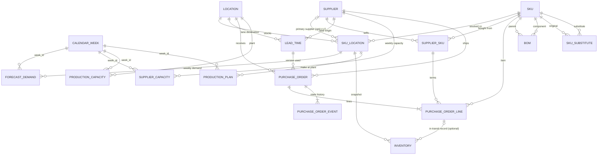
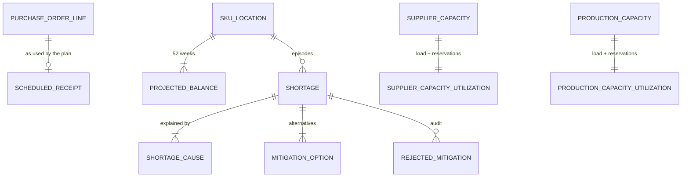

# Data model

17 input tables (the 11 core entities from the brief plus bridges, history and supporting tables), 10 derived
planning outputs, and 1 separate ground-truth table. Field-level detail (types, required/optional, allowed values,
units, uniqueness, validation rules) is in [`data_dictionary.md`](data_dictionary.md), generated from
`src/supply_planning/schema.py`.

## Entity-relationship diagram (inputs)

## Derived outputs and traceability

`shortage_cause.evidence_record_ids` holds the IDs of the exact source rows behind each cause (PO lines, demand
rows, capacity rows, production plans, projected-balance rows). `mitigation_option` references the supplier, PO,
source location, substitute or substitution link it would use. `detected_issue` references the offending record.
Together these trace every shortage and every decision back to source data.

## Cardinality and optionality

| Relationship | Cardinality | Optional? | Implemented by |
|---|---|---|---|
| SKU - Location | N:M | - | bridge `sku_location` (natural key sku_id+location_id) |
| Supplier - SKU | N:M | - | bridge `supplier_sku` (priority 1 = primary, 2+ = alternates) |
| SKU - SKU (substitution) | N:M | - | self-bridge `sku_substitute` |
| SKU - SKU (bill of materials) | N:M | - | self-bridge `bom` (parent MAKE -> component) |
| Supplier - Location (lanes) | N:M | - | `lead_time` (one row per lane **version**) |
| SKU-location -> ForecastDemand | 1:N | yes (components have none) | composite FK (sku_id, location_id) |
| SKU-location -> Inventory | 1:N | - | composite FK |
| PurchaseOrder -> PurchaseOrderLine | 1:N (>= 1) | - | `po_id` |
| PurchaseOrder -> PurchaseOrderEvent | 1:N (>= 1) | - | `po_id`; status derived from latest event |
| PurchaseOrderLine -> Inventory (IN_TRANSIT) | 1:0..1 | yes | `inventory.po_line_id` (rule: at most one) |
| PurchaseOrder -> LeadTime | N:1 | - | version effective at `order_date` |
| SKU-location primary supplier | N:1 | yes (only purchased items) | `sku_location.primary_supplier_id` |
| Supplier -> SupplierCapacity | 1:N (one per week) | - | natural key supplier_id+week_id |
| Plant -> ProductionCapacity / ProductionPlan | 1:N | - | natural keys |
| Shortage -> ShortageCause | 1:N (>= 1) | - | `shortage_id` |
| Shortage -> MitigationOption | 1:N (>= 1, exactly one recommended) | - | `shortage_id` |
| MitigationOption -> Supplier / PO / Location / SKU / Substitution | N:1 | yes (depends on type) | optional FKs |

## Effective dates

| Table | Fields | Rule |
|---|---|---|
| `sku` | effective_from / effective_to | demand only inside the window; `effective_to` iff PHASE_OUT |
| `lead_time` | effective_from / effective_to + `version` | versions are contiguous and non-overlapping; POs use the version effective at `order_date`; new mitigation orders use the version effective at the as-of date |
| `supplier_sku`, `bom`, `sku_substitute` | effective_from / effective_to | a substitute must be effective on the shortage start date |
| `location`, `supplier`, `sku_location` | effective_from | onboarding / stocking start |

## Lifecycle states

| Entity | States and allowed transitions | Where history lives |
|---|---|---|
| PurchaseOrder | `PLANNED -> CONFIRMED -> IN_TRANSIT -> RECEIVED`; `PLANNED/CONFIRMED -> CANCELLED`; `DELAY_REPORTED` keeps the status (CONFIRMED/IN_TRANSIT) | `purchase_order_event` (append-only; `status`, `transport_delay_days`, `created_at` are derived from it) |
| SKU | `NEW -> ACTIVE -> PHASE_OUT` | effective dates |
| Supplier | `ACTIVE -> ON_HOLD` (ON_HOLD: no new orders) | `status` |
| Substitution | `PENDING -> APPROVED or REJECTED` | `approval_status`, `approved_by`, `approval_date` |
| ProductionPlan | `PLANNED -> FIRM` (inside the 2-week frozen fence) | `status` |
| LeadTime | new version instead of overwrite | `version` + effective dates |
| Shortage | `UNMITIGATED`, `PARTIALLY_MITIGATED`, `MITIGATION_PROPOSED` (derived from the recommended option's coverage) | derived |

History is never overwritten. Lead-time changes add a version, PO state changes add events, and engine corrections
(UoM, lead time, capacity deferral) are written to the derived `scheduled_receipt` table with `adjustment_codes`.
Source rows are left exactly as recorded.

## Scale

| Table | starter | full |
|---|---:|---:|
| sku | 300 | 3,000 |
| location | 10 (2 plants) | 50 (5 plants) |
| supplier | 50 | 500 |
| calendar weeks of demand | 52 | 52 |
| purchase orders (inbound orders) | 1,000 baseline + 9 labelled edge-case POs | 10,000 baseline + 30 labelled edge-case POs |

Each SKU is stocked at 1 to 3 locations rather than all 50, which gives about 4,200 SKU-locations x 52 weeks (about
171k demand rows) at full scale. A full cross product of 3,000 x 50 would mean every SKU is stocked everywhere,
which is unrealistic and would leave about 0.07 purchase orders per SKU-location.
